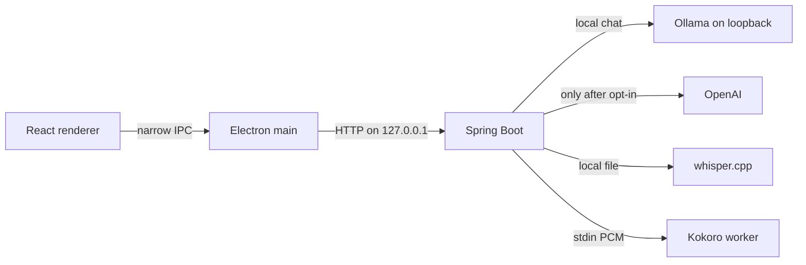

# Architecture

EVA (Electronic Virtual Assistant) is a local desktop assistant. A React interface sits inside a sandboxed Electron window. Electron owns the operating-system privileges and talks to a Java core that is bound to loopback. Milestone 1 is the shell and the health check. Milestone 2 adds conversation through a provider interface. Ollama is the default and stays on the machine. OpenAI runs only after an explicit opt-in. Milestone 3 adds microphone capture and local whisper.cpp transcription, then Kokoro playback through a resident Python worker. Tools, mail, permanent memory, and computer automation are not implemented.

## Processes

| Process | Responsibility | What it cannot do |
| --- | --- | --- |
| Renderer | Draw the interface, subscribe to status, capture the microphone, and send the conversation the user typed | Use Node.js, read the session token or an API key, open OS files, or choose the transcription program |
| Electron main | Create the window, start and stop Java, hold the session token, proxy conversation and speech HTTP | Expose a general-purpose IPC or shell bridge |
| Java backend | Answer health checks, run the selected conversation provider, transcribe speech locally, and shut down when asked | Listen on a non-loopback address, call OpenAI unless that send opted in, or run a program path supplied by the request |

The renderer is loaded with `contextIsolation`, `sandbox`, and `nodeIntegration: false`. The preload script exposes one object, `window.eva`, with these operations:

- `getBackendStatus()`
- `subscribeBackendStatus(listener)`
- `getAppInfo()`
- `getConversation()`
- `sendConversation(request)`
- `resetConversation()`
- `cancelConversation()`
- `getSpeechStatus()`
- `transcribeSpeech(wav)`
- `cancelSpeech()`

Payloads are checked against `shared/contract.ts` in the preload before React sees them. Unknown fields are rejected. The main process accepts IPC only from the Vite dev server in development, and only from the built `index.html` in a packaged shell. Subframes are rejected. Window opens are denied, so the shell does not hand a URL to the system browser.

## Backend

The core is a Spring Boot 4 application on Java 21. Every route, including conversation, goes through the same loopback filter. The routes are:

- `GET /api/health` returns `{ status, service, version, timestamp }`.
- `POST /api/shutdown` asks the process to exit after the response is sent.
- `GET /api/conversation` returns the in-memory transcript and the provider catalog.
- `POST /api/conversation` sends one message to the selected provider and streams newline-delimited JSON events: `delta` pieces, then one `done` event with the full text and usage, or an `error` event. Each line is flushed before the next chunk is produced. Spring Framework 7 otherwise ignores `flush()` on a `StreamingResponseBody` (`spring.http.response.flush.enabled` in `spring.properties`), and the whole reply would arrive in one block. Validation failures such as `cloud-denied` are still a single JSON error and do not open a stream.
- `POST /api/conversation/reset` drops the transcript.
- `POST /api/conversation/cancel` cancels the in-flight reply when the provider call can be interrupted.
- `GET /api/speech` reports whether whisper.cpp and its model are configured.
- `POST /api/speech/transcribe` accepts one 16 kHz mono PCM WAV body. Optional headers `X-Eva-Language` (`auto`, `en`, `fr`, or `ar`), `X-Eva-Prompt` (a percent-encoded vocabulary hint), and `X-Eva-Recording-Ms` are checked again by the core. The response is `{ text, elapsedMs, recordingMs, loadMs, inferenceMs }`. The bytes are not a path. The process arguments come from `EVA_WHISPER_EXECUTABLE` and `EVA_WHISPER_MODEL`, plus `-l` and, only when the vocabulary is non-empty, one `--prompt` argument. Nothing in the request is written to the log.
- `POST /api/speech/cancel` stops the in-flight transcription.

`ChatProvider` is the only model interface. `OllamaChatProvider` and `OpenAiChatProvider` both implement it. `ConversationService` selects one provider from the request. It does not fall back to the other. OpenAI is refused with `cloud-denied` when `cloudEnabled` is false, and that check happens before the cloud client is used.

`LoopbackBindingConfig` sets the listen address to `127.0.0.1` after Spring applies configuration, so `--server.address=0.0.0.0` does not publish the port. A request still has to pass `LoopbackSessionFilter`:

- the remote address must be loopback
- the `Host` header must be `localhost`, `127.0.0.1`, or `[::1]`
- a `POST` with an `Origin` header is rejected, which blocks browser cross-site calls
- `Authorization: Bearer …` must match the session token

The comparison hashes both strings with SHA-256 and uses `MessageDigest.isEqual`. The token is never written into source, logs, or the runtime pid file. Electron generates 32 random bytes at launch and passes them only in the child process environment, not on the command line. Before the application context refreshes, the backend copies that value onto the session bean, removes it from Spring's property sources, and arms a log filter. Debug and trace logs do not print the token, and `eva.session-token` no longer resolves from the environment.

The process refuses to start when `EVA_SESSION_TOKEN` is missing, shorter than 32 characters, or contains whitespace.

`EVA_OPENAI_API_KEY` is optional. When it is present, the same startup step copies it onto a credential bean, removes it from Spring's property sources, and arms the log filter for values of at least 16 characters. Provider errors return a fixed detail string. Exception text from the cloud SDK is not copied into the response, because that text can contain request data.

Ollama's base URL is `EVA_OLLAMA_BASE_URL`, defaulting to `http://127.0.0.1:11434`. It must be an `http` loopback URL with no user info and no path. Discovery is `GET /api/tags` with an 800 millisecond timeout. Chat is `POST /api/chat` with `stream` set to true and a 90 second timeout. EVA never calls `/api/pull`. OpenAI uses LangChain4j `OpenAiStreamingChatModel` with a 45 second timeout and request and response logging off. The cloud model list is a static allowlist (`gpt-4o-mini`, `gpt-4o`, `gpt-4.1-mini`, and `gpt-6-luna`), so describing OpenAI does not contact the network. Choosing OpenAI in the panel selects `gpt-6-luna`. Ollama is still the provider selected when the window opens, and every allowlisted model stays selectable. GPT-6 Luna is requested with reasoning effort `none`. The other allowlisted models do not set a reasoning effort. Cost estimates use the final usage object. The completion count includes reported reasoning tokens when that count is larger than the completion count. Deltas are not logged.

## Startup and shutdown

1. Electron takes a single-instance lock.
2. It resolves `java` from `JAVA_HOME` or `PATH` and requires major version 21 or newer.
3. It locates `backend/target/eva-backend-0.1.0.jar`.
4. It chooses a free loopback port and starts `java -jar` with `--server.port`.
5. It polls `GET /api/health` until the contract matches, the process exits, or 45 seconds pass.
6. The window is shown as soon as it is ready. Status changes are pushed to the renderer.
7. Closing the window calls `POST /api/shutdown`, waits for the process to exit, and kills it if it is still alive. On Windows a process that survives that kill is ended with `taskkill`. Quitting during startup, and a fatal error in the shell, use the same shutdown. If the core exits on its own, the shell reports the connection as down and stops polling.

A pid file in the temp directory records the backend pid and port, never the token. On the next launch EVA stops a previous process only when that pid's command line contains the backend jar name.

## Conversation

The personality text is `backend/src/main/resources/personality/eva-system-prompt.txt`. It is loaded once and passed as the system message. Application code does not embed a second prompt, and the request does not add account, file, or device data.

Context is the Java list of user and assistant turns. A finished reply is committed only after it completes, with status `complete`. Reset increments a generation counter so an in-flight reply cannot be appended as a finished answer. A second send while one is in flight returns `busy`. Bounds are 4,000 characters per message, 16 turns, and 8,000 characters of history.

Stopping a reply keeps the user question in that list. Text already produced is stored on the assistant turn with status `stopped`, which is not a completed response. If nothing was produced, the user turn is stored with status `stopped` and there is no assistant turn. Stopped assistant text stays visible in the catalog React shows. It is left out of the next model request. The user question is included. React does not keep a second history: after stop it shows the catalog Java stored, and Java builds the next provider request from that catalog by dropping assistant turns whose status is `stopped`.

Electron reads the newline-delimited stream on the loopback connection and forwards each new `delta` to the trusted renderer on `eva:conversation:event`. The invoke resolves with the final reply. The renderer appends a sequence number once and replaces the bubble with the final text, so a repeated chunk is not shown twice. Stop aborts the desktop read, asks Java to cancel the upstream call, and ignores later chunks. The input is cleared. The orb returns to `idle`. The question and any partial text stay on screen, marked Stopped.

The HUD keeps the Milestone 1 layout. The conversation panel shows the active provider, local or cloud, the selected model, bubbles, errors, and token or cost figures when the provider returned usage. The orb's `data-phase` is `idle`, `processing`, `responding`, or `error`. `data-state` is still the core connection, not the model. The activity panel remains a local shell feed and still says it is not connected to AI.

## Interface

The screen is a local HUD: an animated orb, a connection pill driven by the live health check, a working conversation panel, and an activity panel. The activity list shows shell events from this process, not an agent log. Motion animates the entrance of the orb and panels, and the stylesheet respects `prefers-reduced-motion`.

Fonts are bundled with the app. The interface does not load assets from a third-party host.

## Design decisions

**The renderer does not call Java.** If React held the token, any script that reached the page could shut the core down or read health as an authenticated client. Keeping the token in the main process means a compromised page still has to get through the IPC allowlist.

**Spring Security is not on the classpath.** The surface is the health and shutdown routes plus the conversation routes, all behind one header check. A servlet filter is easier to audit than a security auto-configuration.

**Traffic stays on HTTP.** The socket is loopback-only. TLS would require a certificate and would not stop another process running as the same user. That residual risk is accepted for this milestone.

**The token is an environment variable.** Command-line arguments are easier to see in process listings. The environment is still visible to the same user. It is not stored in the repository, a config file, or the renderer. Spring drops the session token and the optional OpenAI key from its property sources before refresh, so a configuration dump cannot include either value.

**There is no actuator and no static file serving.** The Java process is not a general web app. Error responses omit messages, stack traces, and exception types.

**The activity feed is still presentational.** It is not an automation log. Conversation and local speech recognition are separate from it. Speech uses `SpeechEngine`, implemented by whisper.cpp. The desktop captures the microphone only for the trusted window, and the renderer cannot choose the executable or the model path. A later capability still needs an explicit IPC channel and a backend route, both of which inherit the checks above.

**Microphone permission is audio-only.** Electron denies every other permission except a narrow `speaker-selection` grant. `media` is granted only for the main frame of the Vite origin in development, or the built `index.html` in production, and only when the request is audio without video. `speaker-selection` uses the same origin and main-frame check so `AudioContext.setSinkId()` can target a speaker. Camera, display capture, USB, and every other permission stay denied. `webSecurity` stays on.

**The dev server is loopback too.** Vite listens on `127.0.0.1:5173`. Production loads `frontend/dist` over `file:`.

## Kokoro playback

`TextToSpeechEngine` is implemented by `KokoroSpeechEngine`. The desktop calls `POST /api/tts/synthesize` with a voice, a speed, and the already-normalized sentence. Java starts `python -u worker.py` from the four absolute `EVA_KOKORO_*` paths, once. The child environment keeps the operating-system paths and drops `EVA_SESSION_TOKEN` and `EVA_OPENAI_API_KEY`. The worker sets Hugging Face offline mode itself. Stdout is a JSON header followed by raw PCM. Stderr is discarded. There is no shell and no extra HTTP server.

The model stays loaded. Cancel writes one line and the page stops the `AudioContext` immediately. A `Kokoro.create` call that has already started still finishes inside the worker; Java drops that audio if the request is no longer current, and it does not send the next sentence. Quitting EVA destroys the worker with the Java process tree.

The worker clips samples to the range −1 to 1 and converts them to 16-bit PCM once. Java wraps those bytes as WAV without scaling them again. The page decodes that WAV into one buffer source, then connects source, gain, level meter, and the context destination in a single chain. Gain follows the slider in even loudness steps across 30 dB, ramped over 30 ms when the slider moves. Full scale stays at unity. Zero is silent. Electron 45.4.1's Chromium supports `AudioContext.setSinkId()`. EVA calls that on the existing context. The graph is not rebuilt and an `<audio>` element is not added, so sound is not connected to two outputs. Changing the sink stops the current buffer. The next buffer uses the new device. A missing `setSinkId` refuses a chosen speaker and still plays the system default.

Playback begins after a reply is complete. Sentence overlap is only that queue. Speaking while tokens are still arriving is left for a later milestone, because a stopped reply must not be spoken. Voices are the five English Kokoro ids plus `ff_siwis`. Arabic is absent from Kokoro-82M v1.0.

## Audio devices

Device choice stays in the renderer. There is no Java route and no Python change. `enumerateDevices()` fills the Audio section. `getUserMedia({ deviceId: { exact } })` records and tests a chosen microphone. Omitting `deviceId` follows the OS default on the next capture. A recording that is already open is discarded if the user picks another microphone or the track ends. The test path is an analyser only: no `MediaRecorder`, no WAV, and no `/api/speech` call. Tracks close when the test stops, the Audio section unmounts, Speak starts, or the window closes.

Output preference is an `AudioContext` sink id. An empty id is the system default. The preferred id and the id actually available are separate. If the preferred speaker is absent, playback is held and is not moved to another device. When that id is listed again, the sink is armed and nothing plays until the user asks. Preferences live in `audio-device-preferences.json` under Electron user data, with exactly `inputDeviceId` and `outputDeviceId`. Invalid files become `default` for both. The ids are not added to conversation or speech requests and are not logged.

`devicechange` refreshes the lists. A stale enumeration is dropped when a newer one finished first. Closing the window removes that listener, stops microphone tracks, and closes the playback context.

## Future: a resident whisper.cpp process

The working path starts `whisper-cli` for every recording. That process loads the ggml weights, transcribes one WAV, and exits. Wall-clock time therefore includes model load every time. On CPU, multilingual Small spent most of the wait in inference; multilingual Base is the practical default because recognition is much shorter. Load time is still paid on every utterance. The status line shows the wall-clock duration. When whisper.cpp prints `load time` and `total time`, the tooltip splits model load from recognition. Those numbers, the audio, the vocabulary, and the transcript are not written to the log.

A later change can keep one `whisper-server` process. That server is not implemented.

**Expected shape.** Electron would start the server only from an allowlisted absolute path (`whisper-server` or `whisper-server.exe`) and the same absolute multilingual model path. The server binds `127.0.0.1` only. The renderer never talks to it. Transcription requests still enter through the session-token loopback API. The server loads the model once. Later requests carry the WAV bytes, the language, and the optional prompt. Arguments stay a fixed list. There is no shell. EVA stops the server on quit and still deletes any temporary WAV.

**Security.** Another process running as the same user can still reach loopback, so the server needs its own check or should accept connections only from the local core. It must not listen on a LAN address. Vocabulary and transcripts should travel in the request body of the already-running server, not as arguments that remain visible for the whole session. The one-shot CLI path does pass `--prompt` as a single argument because `whisper-cli` has no other prompt channel; that argument lives only as long as the process and is not logged. The executable allowlist stays. The renderer and the model output cannot choose a path. EVA still does not download the binary or the model. Request bodies are not logged.

**Resources.** Multilingual Base is about 150 MB of weights plus runtime memory. Small is larger and was too slow on CPU for interactive use. A resident process holds that memory for the session. Vulkan on AMD needs a whisper.cpp build with `GGML_VULKAN=ON`, a current Vulkan driver, and `EVA_WHISPER_GPU=vulkan`. GPU memory for Base is modest. Vulkan shortens inference. A resident process is what removes the repeated model load.

**Install, when that work starts.** Build whisper.cpp, including the `whisper-server` target. For AMD, configure CMake with `-DGGML_VULKAN=ON`. Download a multilingual `ggml-base.bin` yourself. Do not use a `.en.bin` model, and do not commit the binary or the weights. The current setting `EVA_WHISPER_EXECUTABLE` still points at `whisper-cli`. A future setting would point at `whisper-server` instead.

## Known limitations

- A process running as the same desktop user can read the Java process environment and present the session token or the OpenAI key.
- Loopback HTTP is not encrypted. Local software can observe it, including a conversation with Ollama.
- Conversation context is memory only. It is gone after reset, shutdown, or a crash. There is no database.
- Stop keeps the question and any partial text already produced. That partial text is marked stopped and is not sent as a completed answer on the next request. The question is sent.
- Ollama must already be running and the model must already be installed. EVA will not start Ollama or pull a model.
- whisper.cpp and a multilingual ggml model must already be installed. EVA will not download either one. `ggml-base.bin` is the practical CPU default; multilingual Small was too slow because every recording reloads the model and then runs inference on the CPU. AMD GPU use needs a Vulkan build and `EVA_WHISPER_GPU=vulkan`. A resident `whisper-server` is documented and not built. Recordings are capped at 60 seconds. The vocabulary prompt is a hint. Live microphone and live whisper.cpp runs depend on that local setup.
- Kokoro playback needs Python 3.12, the pinned packages in `speech/kokoro/requirements.txt`, and the two v1.0 weight files. EVA does not download them. The worker uses the CPU runtime so the AMD GPU stays available for Ollama. One ONNX call cannot be interrupted; stopping speech drops the audio and skips the rest of the queue. French is `ff_siwis` only. Arabic is not available. Mid-reply speech during token streaming is not implemented.
- Audio device ids come from Chromium and can change between sessions, especially for Bluetooth. EVA will not substitute a different device that happens to have the same label. Switching output during playback stops the current sound instead of retargeting a live buffer. A recording that starts before the device list has loaded uses the system default.
- OpenAI cost is an estimate from a small rate table, and only when the API returns token counts. It is not an invoice.
- The unit tests mock both providers. CI does not need a running Ollama or a paid OpenAI account. A mocked test is not a claim that the live provider answered. Separately, GPT-6 Luna was live-tested once through EVA with a real OpenAI key, and that send succeeded. No other OpenAI model has been live-tested.
- If the shell process is terminated without running its quit handlers, the pid file is the recovery path. A reused pid whose command line cannot be confirmed is left alone.
- There is no installer. `npm start` launches the shell from the source tree.
- Development builds allow Electron DevTools. Packaged windows disable them.
- GitHub Actions builds and tests the backend, the React app, and the Electron shell on pull requests. This checkout has not executed that workflow on GitHub.

## Not in this milestone

Wake-word activation, always-on listening, computer automation, tool execution, Gmail, calendar, permanent memory, SQLite, background tasks, and hosting the core off this machine are planned only in the sense that they are intentionally absent. They are not stubbed as working features.
