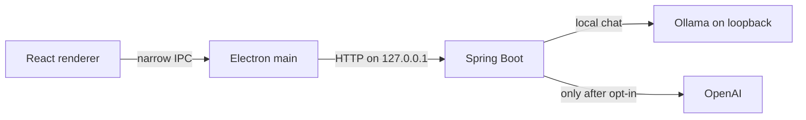

# Architecture

EVA (Electronic Virtual Assistant) is a local desktop assistant. A React interface sits inside a sandboxed Electron window. Electron owns the operating-system privileges and talks to a Java core that is bound to loopback. Milestone 1 is the shell and the health check. Milestone 2 adds conversation through a provider interface. Ollama is the default and stays on the machine. OpenAI runs only after an explicit opt-in. Voice, tools, mail, permanent memory, and computer automation are not implemented.

## Processes

| Process | Responsibility | What it cannot do |
| --- | --- | --- |
| Renderer | Draw the interface, subscribe to status, and send the conversation the user typed | Use Node.js, read the session token or an API key, open OS files |
| Electron main | Create the window, start and stop Java, hold the session token, proxy conversation HTTP | Expose a general-purpose IPC or shell bridge |
| Java backend | Answer health checks, run the selected conversation provider, and shut down when asked | Listen on a non-loopback address, or call OpenAI unless that send opted in |

The renderer is loaded with `contextIsolation`, `sandbox`, and `nodeIntegration: false`. The preload script exposes one object, `window.eva`, with these operations:

- `getBackendStatus()`
- `subscribeBackendStatus(listener)`
- `getAppInfo()`
- `getConversation()`
- `sendConversation(request)`
- `resetConversation()`
- `cancelConversation()`

Payloads are checked against `shared/contract.ts` in the preload before React sees them. Unknown fields are rejected. The main process accepts IPC only from the Vite dev server in development, and only from the built `index.html` in a packaged shell. Subframes are rejected. Window opens are denied, so the shell does not hand a URL to the system browser.

## Backend

The core is a Spring Boot 4 application on Java 21. Every route, including conversation, goes through the same loopback filter. The routes are:

- `GET /api/health` returns `{ status, service, version, timestamp }`.
- `POST /api/shutdown` asks the process to exit after the response is sent.
- `GET /api/conversation` returns the in-memory transcript and the provider catalog.
- `POST /api/conversation` sends one message to the selected provider and streams newline-delimited JSON events: `delta` pieces, then one `done` event with the full text and usage, or an `error` event. Each line is flushed before the next chunk is produced. Spring Framework 7 otherwise ignores `flush()` on a `StreamingResponseBody` (`spring.http.response.flush.enabled` in `spring.properties`), and the whole reply would arrive in one block. Validation failures such as `cloud-denied` are still a single JSON error and do not open a stream.
- `POST /api/conversation/reset` drops the transcript.
- `POST /api/conversation/cancel` cancels the in-flight reply when the provider call can be interrupted.

`ChatProvider` is the only model interface. `OllamaChatProvider` and `OpenAiChatProvider` both implement it. `ConversationService` selects one provider from the request. It does not fall back to the other. OpenAI is refused with `cloud-denied` when `cloudEnabled` is false, and that check happens before the cloud client is used.

`LoopbackBindingConfig` sets the listen address to `127.0.0.1` after Spring applies configuration, so `--server.address=0.0.0.0` does not publish the port. A request still has to pass `LoopbackSessionFilter`:

- the remote address must be loopback
- the `Host` header must be `localhost`, `127.0.0.1`, or `[::1]`
- a `POST` with an `Origin` header is rejected, which blocks browser cross-site calls
- `Authorization: Bearer …` must match the session token

The comparison hashes both strings with SHA-256 and uses `MessageDigest.isEqual`. The token is never written into source, logs, or the runtime pid file. Electron generates 32 random bytes at launch and passes them only in the child process environment, not on the command line. Before the application context refreshes, the backend copies that value onto the session bean, removes it from Spring's property sources, and arms a log filter. Debug and trace logs do not print the token, and `eva.session-token` no longer resolves from the environment.

The process refuses to start when `EVA_SESSION_TOKEN` is missing, shorter than 32 characters, or contains whitespace.

`EVA_OPENAI_API_KEY` is optional. When it is present, the same startup step copies it onto a credential bean, removes it from Spring's property sources, and arms the log filter for values of at least 16 characters. Provider errors return a fixed detail string. Exception text from the cloud SDK is not copied into the response, because that text can contain request data.

Ollama's base URL is `EVA_OLLAMA_BASE_URL`, defaulting to `http://127.0.0.1:11434`. It must be an `http` loopback URL with no user info and no path. Discovery is `GET /api/tags` with an 800 millisecond timeout. Chat is `POST /api/chat` with `stream` set to true and a 90 second timeout. EVA never calls `/api/pull`. OpenAI uses LangChain4j `OpenAiStreamingChatModel` with a 45 second timeout and request and response logging off. The cloud model list is a static allowlist (`gpt-4o-mini`, `gpt-4o`, `gpt-4.1-mini`, and `gpt-6-luna`), so describing OpenAI does not contact the network. GPT-6 Luna is requested with reasoning effort `none`. The other allowlisted models do not set a reasoning effort. Cost estimates use the final usage object. The completion count includes reported reasoning tokens when that count is larger than the completion count. Deltas are not logged.

## Startup and shutdown

1. Electron takes a single-instance lock.
2. It resolves `java` from `JAVA_HOME` or `PATH` and requires major version 21 or newer.
3. It locates `backend/target/eva-backend-0.1.0.jar`.
4. It chooses a free loopback port and starts `java -jar` with `--server.port`.
5. It polls `GET /api/health` until the contract matches, the process exits, or 45 seconds pass.
6. The window is shown as soon as it is ready. Status changes are pushed to the renderer.
7. Closing the window calls `POST /api/shutdown`, waits for the process to exit, and kills it if it is still alive. On Windows a process that survives that kill is ended with `taskkill`. Quitting during startup, and a fatal error in the shell, use the same shutdown. If the core exits on its own, the shell reports the connection as down and stops polling.

A pid file in the temp directory records the backend pid and port, never the token. On the next launch EVA stops a previous process only when that pid's command line contains the backend jar name.

## Conversation

The personality text is `backend/src/main/resources/personality/eva-system-prompt.txt`. It is loaded once and passed as the system message. Application code does not embed a second prompt, and the request does not add account, file, or device data.

Context is the Java list of user and assistant turns. It is committed only after a successful reply. Reset increments a generation counter so an in-flight reply cannot be appended. A second send while one is in flight returns `busy`. Bounds are 4,000 characters per message, 16 turns, and 8,000 characters of history.

Electron reads the newline-delimited stream on the loopback connection and forwards each new `delta` to the trusted renderer on `eva:conversation:event`. The invoke resolves with the final reply. The renderer appends a sequence number once and replaces the bubble with the final text, so a repeated chunk is not shown twice. Context is still committed only after the reply finishes. Cancel aborts the desktop read, asks Java to cancel, and drops uncommitted text. A reply that arrives after cancel or reset is discarded. The upstream call is closed when its handle or stream is available. An incomplete stream is an error and is not stored.

The HUD keeps the Milestone 1 layout. The conversation panel shows the active provider, local or cloud, the selected model, bubbles, errors, and token or cost figures when the provider returned usage. The orb's `data-phase` is `idle`, `processing`, `responding`, or `error`. `data-state` is still the core connection, not the model. The activity panel remains a local shell feed and still says it is not connected to AI.

## Interface

The screen is a local HUD: an animated orb, a connection pill driven by the live health check, a working conversation panel, and an activity panel. The activity list shows shell events from this process, not an agent log. Motion animates the entrance of the orb and panels, and the stylesheet respects `prefers-reduced-motion`.

Fonts are bundled with the app. The interface does not load assets from a third-party host.

## Design decisions

**The renderer does not call Java.** If React held the token, any script that reached the page could shut the core down or read health as an authenticated client. Keeping the token in the main process means a compromised page still has to get through the IPC allowlist.

**Spring Security is not on the classpath.** The surface is the health and shutdown routes plus the conversation routes, all behind one header check. A servlet filter is easier to audit than a security auto-configuration.

**Traffic stays on HTTP.** The socket is loopback-only. TLS would require a certificate and would not stop another process running as the same user. That residual risk is accepted for this milestone.

**The token is an environment variable.** Command-line arguments are easier to see in process listings. The environment is still visible to the same user. It is not stored in the repository, a config file, or the renderer. Spring drops the session token and the optional OpenAI key from its property sources before refresh, so a configuration dump cannot include either value.

**There is no actuator and no static file serving.** The Java process is not a general web app. Error responses omit messages, stack traces, and exception types.

**The activity feed is still presentational.** It is not an automation log. Conversation is no longer a placeholder: the renderer calls the four conversation channels and does not choose a different code path for Ollama and OpenAI. A later capability still needs an explicit IPC channel and a backend route, both of which inherit the checks above.

**The dev server is loopback too.** Vite listens on `127.0.0.1:5173`. Production loads `frontend/dist` over `file:`.

## Known limitations

- A process running as the same desktop user can read the Java process environment and present the session token or the OpenAI key.
- Loopback HTTP is not encrypted. Local software can observe it, including a conversation with Ollama.
- Conversation context is memory only. It is gone after reset, shutdown, or a crash. There is no database.
- Cancel closes the desktop read immediately. If the provider has not produced a chunk yet, the upstream request can still finish, and EVA drops that text. An incomplete stream is not stored.
- Ollama must already be running and the model must already be installed. EVA will not start Ollama or pull a model.
- OpenAI cost is an estimate from a small rate table, and only when the API returns token counts. It is not an invoice.
- The unit tests mock both providers. CI does not need a running Ollama or a paid OpenAI account. A mocked test is not a claim that the live provider answered. Separately, GPT-6 Luna was live-tested once through EVA with a real OpenAI key, and that send succeeded. No other OpenAI model has been live-tested.
- If the shell process is terminated without running its quit handlers, the pid file is the recovery path. A reused pid whose command line cannot be confirmed is left alone.
- There is no installer. `npm start` launches the shell from the source tree.
- Development builds allow Electron DevTools. Packaged windows disable them.
- GitHub Actions builds and tests the backend, the React app, and the Electron shell on pull requests. This checkout has not executed that workflow on GitHub.

## Not in this milestone

Voice, computer automation, tool execution, Gmail, calendar, permanent memory, SQLite, background tasks, and hosting the core off this machine are planned only in the sense that they are intentionally absent. They are not stubbed as working features.
