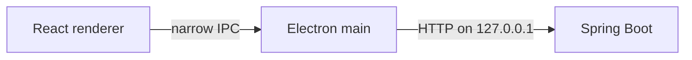

# Architecture

JARVIS Milestone 1 is a local desktop shell. A React interface sits inside a sandboxed Electron window. Electron owns the operating-system privileges and talks to a Java core that is bound to loopback. Nothing in this milestone calls a model, microphone, mailbox, or external API.

## Processes

| Process | Responsibility | What it cannot do |
| --- | --- | --- |
| Renderer | Draw the interface and subscribe to status | Use Node.js, read the session token, open OS files |
| Electron main | Create the window, start and stop Java, hold the session token | Expose a general-purpose IPC or shell bridge |
| Java backend | Answer health checks and shut down when asked | Listen on a non-loopback address |

The renderer is loaded with `contextIsolation`, `sandbox`, and `nodeIntegration: false`. The preload script exposes one object, `window.jarvis`, with three operations:

- `getBackendStatus()`
- `subscribeBackendStatus(listener)`
- `getAppInfo()`

Payloads are checked against `shared/contract.ts` in the preload before React sees them. Unknown fields are rejected. The main process also ignores IPC from any origin other than the Vite dev server in development, or a `file:` URL in a built shell.

## Backend

The core is a Spring Boot 4 application on Java 21. It has two routes:

- `GET /api/health` returns `{ status, service, version, timestamp }`.
- `POST /api/shutdown` asks the process to exit after the response is sent.

`LoopbackBindingConfig` sets the listen address to `127.0.0.1` after Spring applies configuration, so `--server.address=0.0.0.0` does not publish the port. A request still has to pass `LoopbackSessionFilter`:

- the remote address must be loopback
- the `Host` header must be `localhost`, `127.0.0.1`, or `[::1]`
- a `POST` with an `Origin` header is rejected, which blocks browser cross-site calls
- `Authorization: Bearer …` must match the session token

The comparison hashes both strings with SHA-256 and uses `MessageDigest.isEqual`. The token is never written into source, logs, or the runtime pid file. Electron generates 32 random bytes at launch and passes them only in the child process environment, not on the command line.

The process refuses to start when `JARVIS_SESSION_TOKEN` is missing, shorter than 32 characters, or contains whitespace.

## Startup and shutdown

1. Electron takes a single-instance lock.
2. It resolves `java` from `JAVA_HOME` or `PATH` and requires major version 21 or newer.
3. It locates `backend/target/jarvis-backend-0.1.0.jar`.
4. It chooses a free loopback port and starts `java -jar` with `--server.port`.
5. It polls `GET /api/health` until the contract matches, the process exits, or 45 seconds pass.
6. The window is shown as soon as it is ready. Status changes are pushed to the renderer.
7. Closing the window calls `POST /api/shutdown`, waits for the process to exit, and kills it if it is still alive.

A pid file in the temp directory records the backend pid and port, never the token. On the next launch JARVIS stops a previous process only when that pid's command line contains the backend jar name.

## Interface

The screen is a local HUD: an animated orb, a connection pill driven by the live health check, and two panels. Both panels say **Not connected to AI**. The conversation composer is disabled. The activity list shows shell events from this process, not an agent log. Motion animates the entrance of the orb and panels, and the stylesheet respects `prefers-reduced-motion`.

Fonts are bundled with the app. The interface does not load assets from a third-party host.

## Design decisions

**The renderer does not call Java.** If React held the token, any script that reached the page could shut the core down or read health as an authenticated client. Keeping the token in the main process means a compromised page still has to get through the IPC allowlist.

**Spring Security is not on the classpath.** The surface is two routes and one header. A servlet filter is easier to audit than a security auto-configuration.

**Traffic stays on HTTP.** The socket is loopback-only. TLS would require a certificate and would not stop another process running as the same user. That residual risk is accepted for this milestone.

**The token is an environment variable.** Command-line arguments are easier to see in process listings. The environment is still visible to the same user. It is not stored in the repository, a config file, or the renderer.

**There is no actuator and no static file serving.** The Java process is not a general web app. Error responses omit messages, stack traces, and exception types.

**Placeholders are presentational.** Conversation and activity components receive their copy as props or local constants. A later milestone can replace the data source without giving the renderer Node access. A new capability still needs an explicit IPC channel and a backend route, both of which inherit the checks above.

**The dev server is loopback too.** Vite listens on `127.0.0.1:5173`. Production loads `frontend/dist` over `file:`.

## Known limitations

- A process running as the same desktop user can read the Java process environment and present the session token.
- Loopback HTTP is not encrypted. Local software can observe it.
- If Electron crashes hard enough to skip shutdown, the pid file is the recovery path. A reused pid whose command line cannot be confirmed is left alone.
- Debug logging is off. Turning Spring's debug logger on can print configured property values, including the session token.
- There is no installer. `npm start` launches the shell from the source tree.
- Development builds allow Electron DevTools. Packaged windows disable them.
- This repository does not yet run the GitHub Actions workflow; the same `npm test` command is what that workflow calls.
